# Telco Customer Churn Prediction
**Xinyu Jia (C00304524)** — Data Science & Machine Learning Portfolio
This project uses a Random Forest classifier to predict telecom customer churn, identifies the customer groups associated with higher churn risk, and turns the findings into practical retention recommendations.

## Repository Structure
| File / Folder | Purpose |
|---|---|
| `Telco_Churn_Prediction.ipynb` | Full annotated notebook: data loading, cleaning, EDA, model training and evaluation |
| `README.md` | Written overview of the complete workflow (this file) |
| `DSML spec .docx` | Approved project specification |
| `worklog.md` | Weekly project work log |
| `requirements.txt` | Python dependencies for reproducing the notebook |
| `plots/` | EDA and model output figures |

## 1. Aim
This project builds a binary-classification model to predict whether a telecom customer will leave the service (churn = Yes). The two questions it tries to answer are:
1. Which customer characteristics are most associated with churn?
2. Can a supervised model predict churn reasonably well, and where does it fail?

The practical goal is to point out high-risk customer groups so the company can focus retention effort on them.

## 2. Dataset
- **Name:** Telco Customer Churn
- **Source:** Kaggle dataset uploaded by BlastChar; simulated data originally created by IBM for educational use.
- **Raw data:** 7,043 rows × 21 columns.
- **Target variable:** `Churn` — `Yes` = customer left, `No` = customer stayed.
- **Features:** demographics (gender, senior citizen, partner, dependents), `tenure`, subscribed services, `Contract`, `MonthlyCharges`, `TotalCharges`, `PaymentMethod`, etc.
- **After cleaning:** 7,032 rows × 20 columns; `No` = 5,163, `Yes` = 1,869 (about 26.6% churned). The dataset is therefore mildly imbalanced.
- **Licence / privacy:** publicly shared on Kaggle for educational exploration; the data are simulated and contain no real customer private information.

**Why this dataset was chosen:** it combines categorical and numeric features with clear business meaning, it is large enough for a binary-classification task but does not require heavy cleaning, and the churn topic has a direct retention use case. It is also a standard reference dataset, which makes the results easier to compare and interpret.

### 2.1 Obtaining the dataset
The CSV file is kept out of version control to keep the repository small. After downloading `WA_Fn-UseC_-Telco-Customer-Churn.csv` from the Kaggle link in References, the Colab notebook reads it as follows:
```python
from google.colab import files
files.upload()  # select the downloaded CSV file
df = pd.read_csv("WA_Fn-UseC_-Telco-Customer-Churn.csv")
```
Only the code, plots and this report are tracked; the raw data must be downloaded separately and is not pushed to GitHub.

## 3. Tools and Libraries
- **Language:** Python
- **Data handling:** pandas, NumPy
- **Visualisation:** Matplotlib, Seaborn
- **Modelling:** scikit-learn (`RandomForestClassifier` and class-weighted Random Forest, `GradientBoostingClassifier`, `LogisticRegression` in a `StandardScaler` pipeline, `GridSearchCV`, `train_test_split`, classification metrics, confusion matrix, ROC)
- **Resampling:** imbalanced-learn `SMOTE` for training-set class balancing
- **Environment:** Google Colab (Jupyter notebook)
- **Dependencies:** see `requirements.txt` for the packages used to run the notebook.

## 4. Data Preprocessing
Steps applied before modelling:
1. Dropped `customerID`, because it is only an identifier and has no predictive value.
2. Converted `TotalCharges` from text to numeric; blank/space values were turned into missing values with `errors="coerce"`.
3. Dropped the rows with missing `TotalCharges` (new customers with `tenure = 0`), leaving 7,032 rows. These rows were dropped rather than imputed because they are brand-new customers with no recorded monthly spend, so imputing a value would add unreliable information.
4. `SeniorCitizen` is already stored as an integer 0/1, so it was kept as a numeric feature without extra encoding.
5. Binarized the target `Churn` to Yes = 1 / No = 0.
6. One-hot encoded the remaining categorical columns with `drop_first=True`, producing 30 usable features.
7. Split the data 80% / 20% with `stratify=y` to keep the churn ratio consistent in both sets:
   - Train set: 5,625 rows
   - Test set: 1,407 rows (unseen by the model during training)

## 5. Exploratory Data Analysis (EDA)
### 5.1 Cleaned data summary
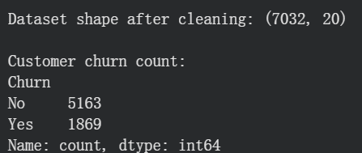
After cleaning, 7,032 customers remain: 5,163 stayed and 1,869 churned (about 26.6%), so churn is a minority but meaningful class.

### 5.2 Overall churn
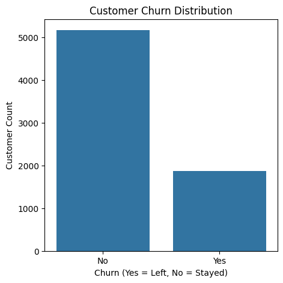
Most customers stayed, but roughly one in four churned, so the minority class still matters for retention decisions.

### 5.3 Contract type
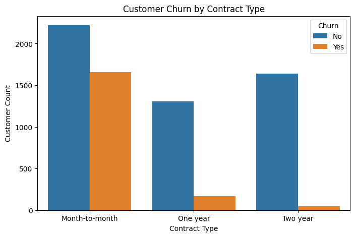
Customers on month-to-month contracts churn far more often than one-year or two-year customers; customers on longer contracts tend to stay more often.

### 5.4 Monthly charges
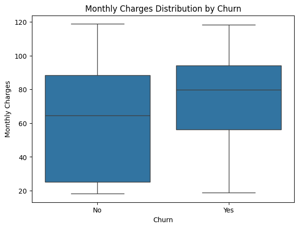
Churned customers generally pay a higher monthly charge; the median `MonthlyCharges` for churned customers is higher than for those who stayed.

### 5.5 Payment method
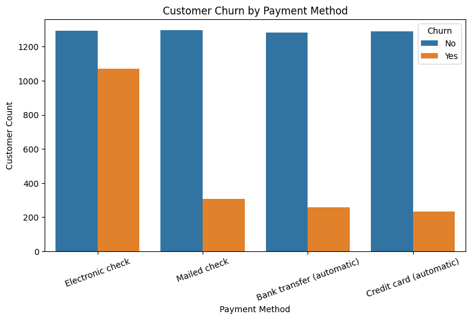
Electronic check users show the highest churn, while automatic payment methods (bank transfer, credit card) have much lower churn.

### 5.6 Internet service
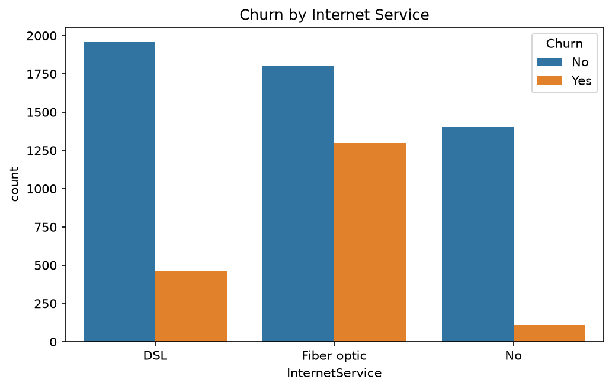
Fiber optic customers churn at about 41.9%, compared with 19.0% for DSL and only 7.4% for customers without internet; fiber service is a clear high-risk group.

### 5.7 Feature correlation with churn
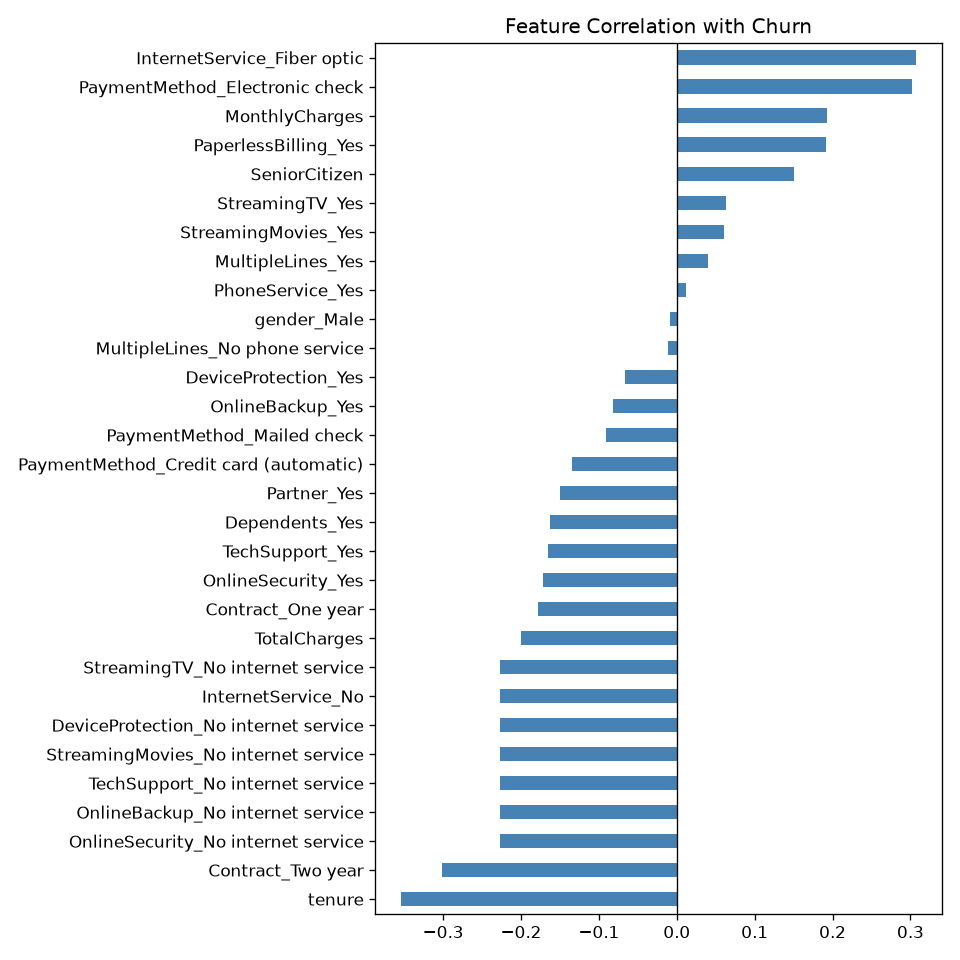
Short tenure and high charges point toward churn, while a two-year contract and security/technical-support services point away from it.

### 5.8 Numeric correlation heatmap
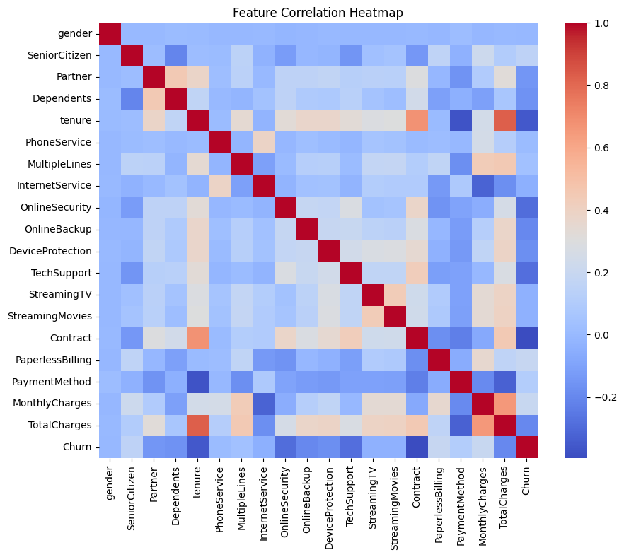
Among numeric variables, tenure moves against churn, while MonthlyCharges and TotalCharges trend positively with it.

## 6. Model
A **Random Forest Classifier** was chosen for this task:
- It handles a mix of categorical and numeric features without requiring feature scaling.
- It captures non-linear relationships and interactions between features.
- It reduces overfitting compared with a single decision tree by averaging many trees.
- It outputs feature importance, which supports business interpretation.
- Algorithm: `RandomForestClassifier(n_estimators=100, random_state=42)`
- Input: 30 one-hot encoded features
- Trained on the 80% training split; predictions and evaluation were made on the held-out 20% test split.

The Random Forest is used as the primary baseline model because it provides feature importance for business interpretation; several alternative models, imbalance handling and tuning experiments are compared against it in section 7.4.

## 7. Model Evaluation
### 7.1 Main metrics
| Metric | Value |
|---|---|
| Accuracy | 0.7896 |
| ROC-AUC | 0.8165 |

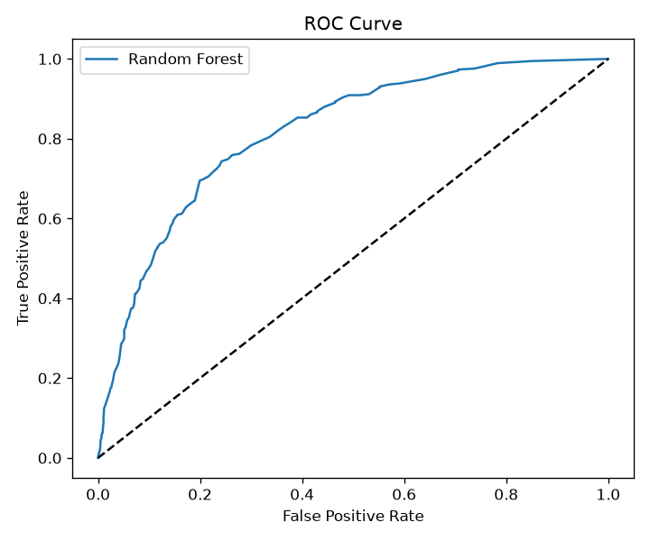

Classification report on the test set:
| Class | Precision | Recall | F1-score | Support |
|---|---|---|---|---|
| Stayed (0) | 0.84 | 0.89 | 0.86 | 1,033 |
| Churned (1) | 0.63 | 0.52 | 0.57 | 374 |
| Accuracy |  |  | 0.79 | 1,407 |
| Macro avg | 0.73 | 0.70 | 0.71 | 1,407 |
| Weighted avg | 0.78 | 0.79 | 0.78 | 1,407 |

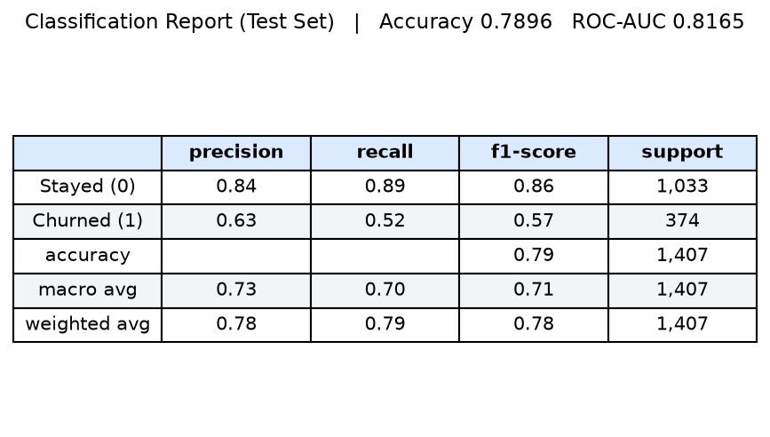

### 7.2 Confusion matrix
| Actual \ Predicted | Predicted Stayed | Predicted Churned |
|---|---|---|
| Actual Stayed | 917 (TN) | 116 (FP) |
| Actual Churned | 180 (FN) | 194 (TP) |

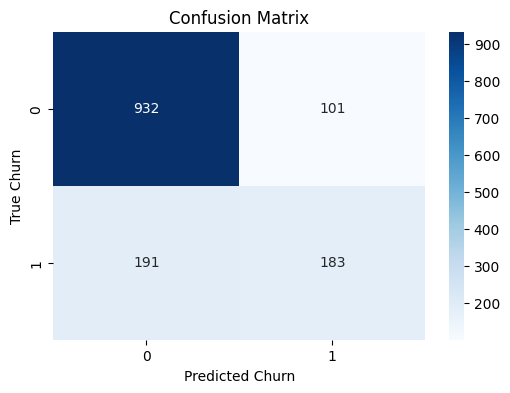

**Reading the results:** the model predicts staying customers reliably (recall 0.89). It identifies about half of the customers who actually churned (churn recall 0.52), meaning many churners are still missed. Because the classes are imbalanced, accuracy alone can be misleading; the ROC-AUC of 0.8165 shows the model separates the two classes reasonably well overall.

### 7.3 Feature importance
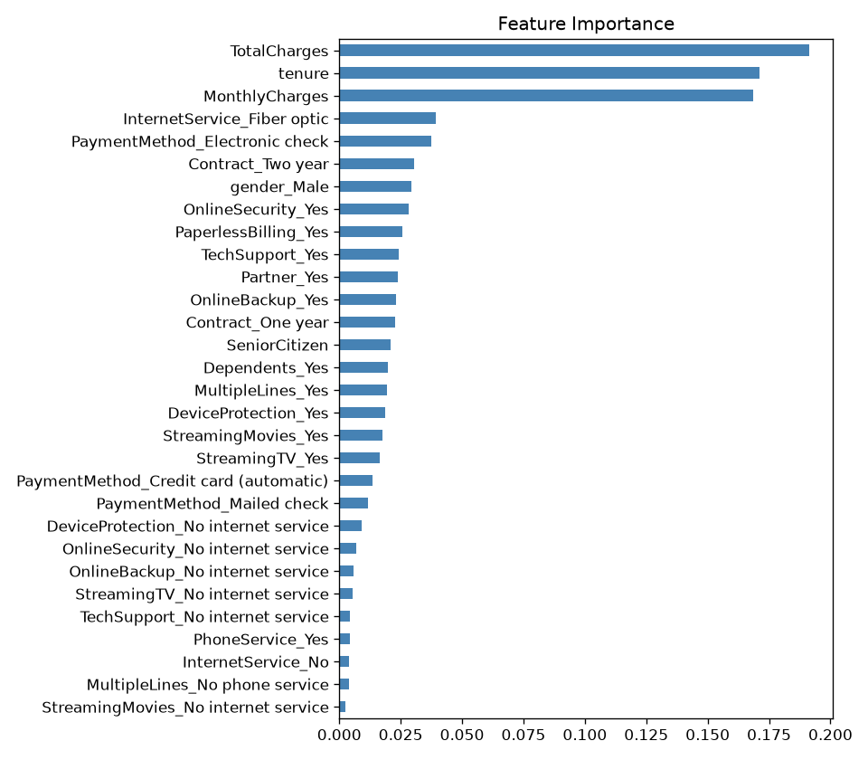
The most important features are:
`TotalCharges`, `tenure`, `MonthlyCharges`, `InternetService_Fiber optic`, `PaymentMethod_Electronic check`, and `Contract_Two year`. This matches the EDA findings: shorter tenure, higher charges, fiber service, and electronic-check payment are associated with higher churn risk.

### 7.4 Model comparison
The default Random Forest was compared with a class-weighted Random Forest, a Logistic Regression model, a Gradient Boosting model, an SMOTE-balanced Random Forest, and a grid-tuned Random Forest on the same held-out test set:

| Model | Accuracy | ROC-AUC | Churn recall | Churn F1 |
|---|---|---|---|---|
| Random Forest | 0.7896 | 0.8165 | 0.5187 | 0.5673 |
| RF (balanced) | 0.7889 | 0.8177 | 0.4920 | 0.5534 |
| Logistic Regression | 0.8038 | 0.8357 | 0.5749 | 0.6091 |
| Gradient Boosting | 0.7953 | 0.8407 | 0.5321 | 0.5802 |
| RF + SMOTE | 0.7783 | 0.8153 | 0.5909 | 0.5862 |
| RF (tuned) | 0.7889 | 0.8345 | 0.5027 | 0.5587 |

**Reading the comparison:** Logistic Regression reaches the highest accuracy (0.8038) and churn F1 (0.6091), with an ROC-AUC of 0.8357. Gradient Boosting reaches the highest ROC-AUC (0.8407) and the second-best accuracy (0.7953). The SMOTE-balanced Random Forest catches the most actual churners (churn recall 0.5909), but its accuracy drops to 0.7783. The class-weighted Random Forest did not improve minority-class recall here (0.4920, below the default 0.5187), so class weighting alone did not help on this dataset. All models stay near 0.78–0.80 accuracy, and the churn class remains difficult to predict.

### 7.5 Class imbalance: SMOTE resampling
Because churn is a minority class (about 26.6%), SMOTE was applied to synthesize new minority-class samples. Resampling was fitted on the **training set only**; the test set was left unchanged to avoid data leakage. The training labels changed from `{stayed: 4,130, churned: 1,495}` to a balanced `{stayed: 4,130, churned: 4,130}`, and a Random Forest was then trained on this balanced training set.

Compared with the default Random Forest, the SMOTE version raises churn recall from 0.5187 to 0.5909 (more churners flagged), but accuracy falls to 0.7783 and ROC-AUC to 0.8153. SMOTE therefore helps catch churners at the cost of more false alarms, which matches the imbalance trade-off.

### 7.6 Decision threshold analysis
The default classification threshold is 0.50. Using the Logistic Regression probabilities, thresholds from 0.30 to 0.60 were compared to show how the decision boundary changes:

| Threshold | Accuracy | Precision | Recall | F1 |
|---|---|---|---|---|
| 0.30 | 0.7434 | 0.5117 | 0.7594 | 0.6114 |
| 0.40 | 0.7832 | 0.5779 | 0.6845 | 0.6267 |
| 0.50 | 0.8038 | 0.6476 | 0.5749 | 0.6091 |
| 0.60 | 0.7903 | 0.6837 | 0.3930 | 0.4992 |

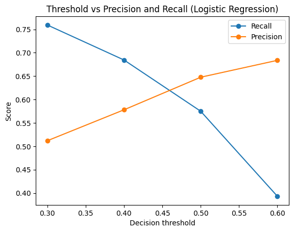

Lowering the threshold flags more customers as churners: recall rises to 0.7594 at 0.30, but precision drops to 0.5117 (more false alarms). Raising the threshold has the opposite effect. The best churn F1 (0.6267) is reached at threshold 0.40, which balances recall and precision. In a retention context, a lower threshold can be chosen when missing a churner is more costly than contacting a loyal customer; a higher threshold suits a limited campaign budget where false contacts should be avoided.

### 7.7 Hyperparameter tuning
A small grid search (`n_estimators` 100/200, `max_depth` None/10, `min_samples_leaf` 1/2) was run over the Random Forest with 5-fold cross-validation, scored on churn-class F1. The best settings were `max_depth=10`, `min_samples_leaf=1`, `n_estimators=100`, with a best cross-validation F1 of 0.5808.

On the held-out test set this tuned Random Forest reached accuracy 0.7889, ROC-AUC 0.8345, churn recall 0.5027 and churn F1 0.5587. Tuning improved ROC-AUC over the baseline (0.8165 → 0.8345) but did not raise minority-class recall or F1, so the grid search gave limited gains on the churn class for this dataset.

## 8. Conclusion and Business Recommendations
**Answer to research question 1 (which characteristics are most associated with churn):** combining the EDA with the feature-importance plot, the features most associated with higher churn risk are short `tenure`, high `TotalCharges` and `MonthlyCharges`, Fiber optic internet, Electronic check payment, and Month-to-month contracts; two-year contracts, OnlineSecurity and TechSupport are associated with customers staying.

**Answer to research question 2 (can churn be predicted):** the six models predict churn near 0.78–0.80 accuracy with ROC-AUC 0.82–0.84. Logistic Regression performs best overall (accuracy 0.8038, churn recall 0.5749, churn F1 0.6091), while Gradient Boosting reaches the highest ROC-AUC (0.8407) and the SMOTE-balanced Random Forest flags the most churners (recall 0.5909). The default Random Forest reaches accuracy 0.7896 and ROC-AUC 0.8165 but misses about half of churners (churn recall 0.52). Even the best model still misses a substantial share of churners, so the output should be used as a risk flag rather than a final decision; the decision threshold can be lowered to catch more churners when retention is prioritised.

- **Longer-contract customers churn less often.** Offer discounts or bundled plans to move month-to-month customers toward one-year / two-year contracts.
- **Replace electronic check with automatic payment.** Encourage bank-transfer or credit-card auto-pay, possibly with a small incentive.
- **Target high-risk segments.** Short-tenure, high-monthly-charge fiber customers should receive early retention offers before they leave.
- **Act on missed churners.** The churn recall (0.52) means the current model should be used as a risk flag rather than a final decision; human review of flagged customers remains necessary.

## 9. Limitations and Future Work
- The data are simulated and educational, so conclusions are for academic demonstration rather than direct commercial use.
- The EDA plots and feature importance show association with churn, not causation; they cannot prove that a feature itself causes a customer to leave.
- Churn-class recall remains moderate. The notebook compares a class-weighted Random Forest, Logistic Regression, Gradient Boosting, an SMOTE-balanced Random Forest and a grid-tuned Random Forest, and also examines the decision threshold (sections 7.4–7.7). Further future work could test stronger boosting models (e.g. XGBoost/LightGBM), build customer segments with clustering, choose the threshold from business retention costs rather than F1, and validate the model on real non-simulated data.

## 10. References
1. BlastChar (n.d.). *Telco Customer Churn* (simulated IBM data). Kaggle. Available at: https://www.kaggle.com/datasets/blastchar/telco-customer-churn (Accessed: 18 November 2026).
2. Scikit-learn developers (n.d.). *scikit-learn: Machine Learning in Python* — `RandomForestClassifier`, `GradientBoostingClassifier`, `LogisticRegression`, `GridSearchCV`, `train_test_split` and classification metrics. Available at: https://scikit-learn.org/stable/ (Accessed: 18 November 2026).
3. The pandas development team (n.d.). *pandas documentation*. Available at: https://pandas.pydata.org/docs/ (Accessed: 18 November 2026).
4. Waskom, M. et al. (n.d.). *Seaborn documentation: statistical data visualization in Python*. Available at: https://seaborn.pydata.org/ (Accessed: 18 November 2026).
5. imbalanced-learn developers (n.d.). *imbalanced-learn: a Python package to tackle imbalanced datasets* — `SMOTE`. Available at: https://imbalanced-learn.org/ (Accessed: 18 November 2026).

## Reproducibility and Originality
- `random_state=42` is fixed so the train/test split and model results can be reproduced.
- This project was completed independently for the continuous assessment; all referenced tools and the dataset are listed above.
- The dataset CSV is excluded from the repository per course guidance; the source link is provided in References.
- To run the notebook: install the packages in `requirements.txt`, upload the CSV as described in section 2.1, and run the cells in order.
