# Telco Customer Churn Prediction

**Xinyu Jia (C00304524)** — Data Science & Machine Learning Portfolio (Draft)

This project uses a Random Forest classifier to predict telecom customer churn, identifies the main drivers of leaving, and turns the findings into practical retention recommendations.

## Repository Structure

| File / Folder | Purpose |
|---|---|
| `Telco_Churn_Prediction.ipynb` | Full annotated notebook: data loading, cleaning, EDA, model training and evaluation |
| `README.md` | Written overview of the complete workflow (this file) |
| `DSML spec .docx` | Approved project specification |
| `plots/` | EDA and model output figures |

## 1. Aim

This project builds a binary-classification model to predict whether a telecom customer will leave the service (churn = Yes). The two questions it tries to answer are:

1. Which customer characteristics drive churn the most?
2. Can a supervised model predict churn reasonably well, and where does it fail?

The practical goal is to point out high-risk customer groups so the company can focus retention effort on them.

## 2. Dataset

- **Name:** Telco Customer Churn
- **Source:** Kaggle dataset uploaded by BlastChar; simulated data originally created by IBM for educational use.
- **Raw data:** 7,043 rows × 21 columns.
- **Target variable:** `Churn` — `Yes` = customer left, `No` = customer stayed.
- **Features:** demographics (gender, senior citizen, partner, dependents), `tenure`, subscribed services, `Contract`, `MonthlyCharges`, `TotalCharges`, `PaymentMethod`, etc.
- **After cleaning:** 7,032 rows × 20 columns; `No` = 5,163, `Yes` = 1,869 (about 26.6% churned). The dataset is therefore mildly imbalanced.
- **Licence / privacy:** publicly shared on Kaggle for educational exploration; the data are simulated and contain no real customer private information.

**Why this dataset was chosen:** it combines categorical and numeric features with clear business meaning, it is large enough for a binary-classification task but does not require heavy cleaning, and the churn topic has a direct retention use case. It is also a standard reference dataset, which makes the results easier to compare and interpret.

## 3. Tools and Libraries

- **Language:** Python
- **Data handling:** pandas, NumPy
- **Visualisation:** Matplotlib, Seaborn
- **Modelling:** scikit-learn (`RandomForestClassifier`, `train_test_split`, classification metrics, confusion matrix, ROC)
- **Environment:** Google Colab (Jupyter notebook)

## 4. Data Preprocessing

Steps applied before modelling:

1. Dropped `customerID`, because it is only an identifier and has no predictive value.
2. Converted `TotalCharges` from text to numeric; blank/space values were turned into missing values with `errors="coerce"`.
3. Dropped the rows with missing `TotalCharges` (new customers with `tenure = 0`), leaving 7,032 rows.
4. `SeniorCitizen` is already stored as an integer 0/1, so it was kept as a numeric feature without extra encoding.
5. Binarized the target `Churn` to Yes = 1 / No = 0.
6. One-hot encoded the remaining categorical columns with `drop_first=True`, producing 30 usable features.
7. Split the data 80% / 20% with `stratify=y` to keep the churn ratio consistent in both sets:
   - Train set: 5,625 rows
   - Test set: 1,407 rows (unseen by the model during training)

## 5. Exploratory Data Analysis (EDA)

### 5.1 Cleaned data summary

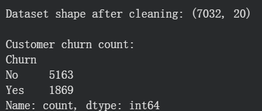

After cleaning, 7,032 customers remain: 5,163 stayed and 1,869 churned (about 26.6%), so churn is a minority but meaningful class.

### 5.2 Overall churn

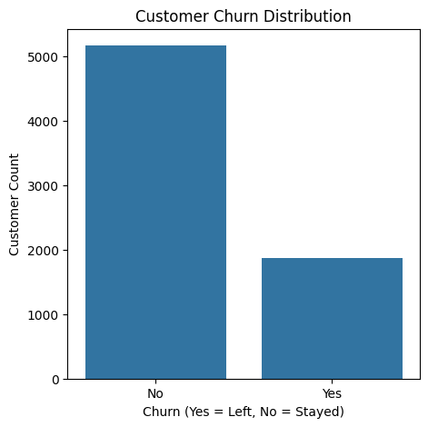

Most customers stayed, but roughly one in four churned, so the minority class still matters for retention decisions.

### 5.3 Contract type

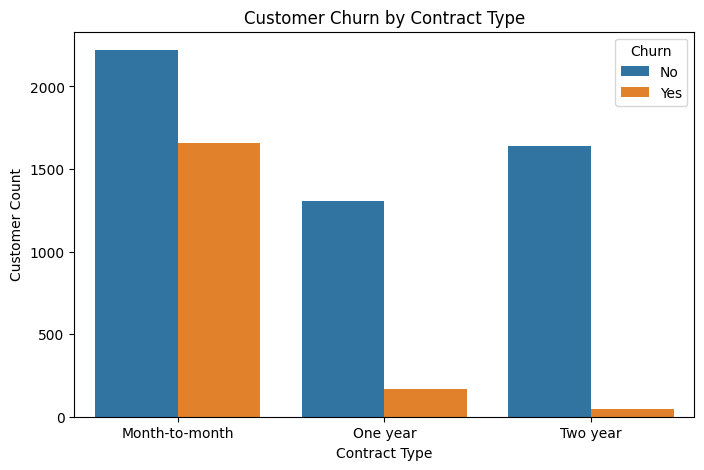

Customers on month-to-month contracts churn far more often than one-year or two-year customers; longer contracts clearly reduce switching.

### 5.4 Monthly charges

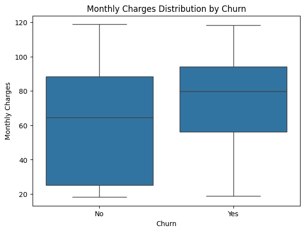

Churned customers generally pay a higher monthly charge; the median `MonthlyCharges` for churned customers is higher than for those who stayed.

### 5.5 Payment method

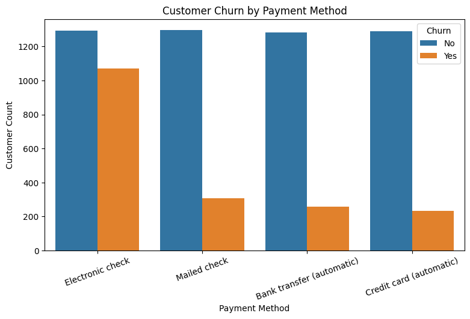

Electronic check users show the highest churn, while automatic payment methods (bank transfer, credit card) have much lower churn.

### 5.6 Internet service

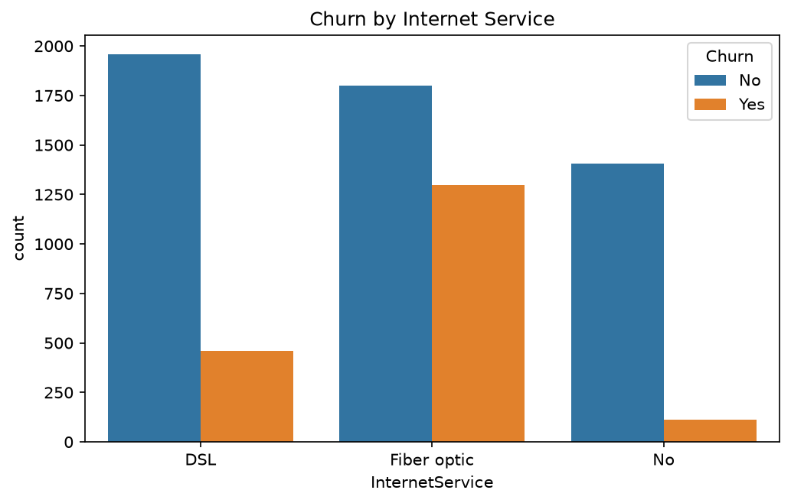

Fiber optic customers churn at about 41.9%, compared with 19.0% for DSL and only 7.4% for customers without internet; fiber service is a clear high-risk group.

### 5.7 Feature correlation with churn

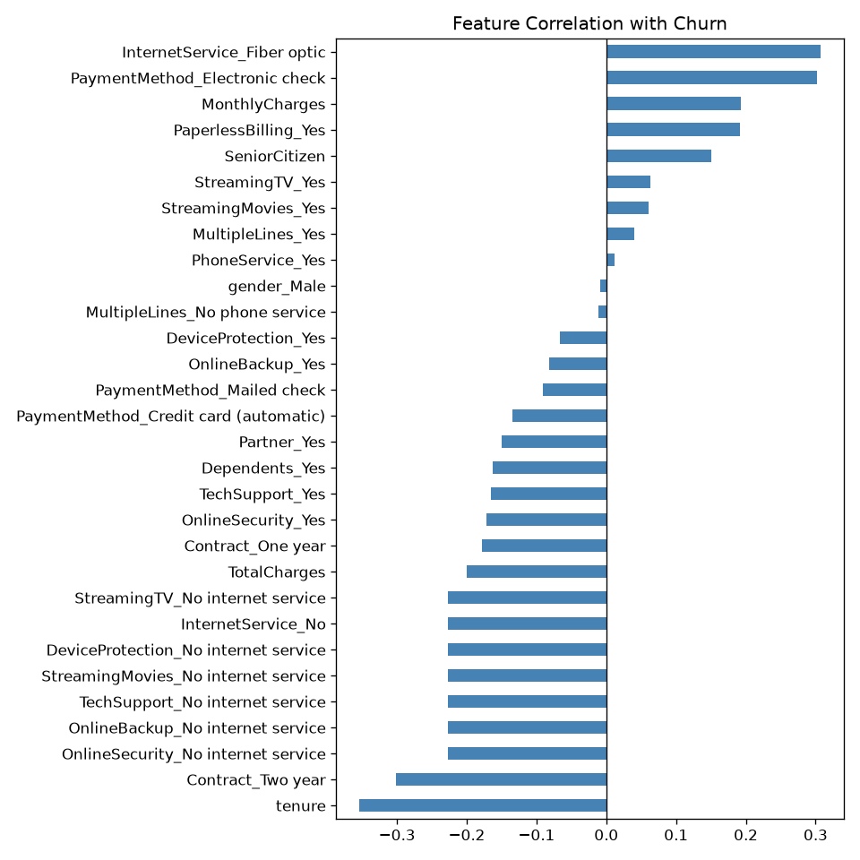

Short tenure and high charges point toward churn, while a two-year contract and security/technical-support services point away from it.

### 5.8 Numeric correlation heatmap

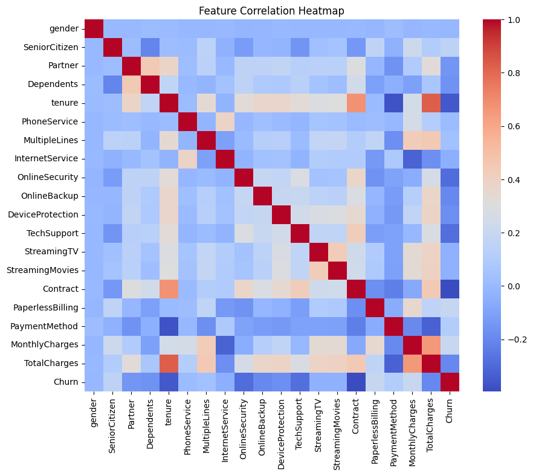

Among numeric variables, tenure moves against churn, while MonthlyCharges and TotalCharges trend positively with it.

## 6. Model

A **Random Forest Classifier** was chosen for this task:

- It handles a mix of categorical and numeric features without requiring feature scaling.
- It captures non-linear relationships and interactions between features.
- It reduces overfitting compared with a single decision tree by averaging many trees.
- It outputs feature importance, which supports business interpretation.

- Algorithm: `RandomForestClassifier(n_estimators=100, random_state=42)`
- Input: 30 one-hot encoded features
- Trained on the 80% training split; predictions and evaluation were made on the held-out 20% test split.

## 7. Model Evaluation

### 7.1 Main metrics

| Metric | Value |
|---|---|
| Accuracy | 0.7896 |
| ROC-AUC | 0.8165 |

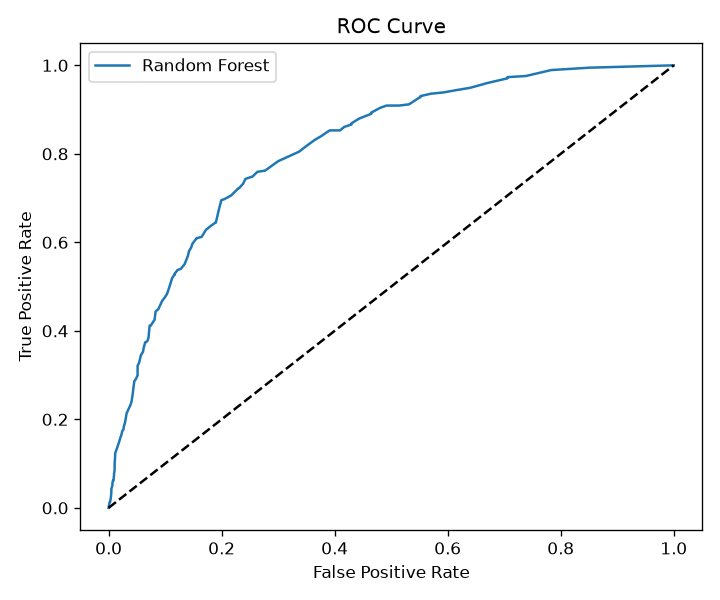

Classification report on the test set:

| Class | Precision | Recall | F1-score | Support |
|---|---|---|---|---|
| Stayed (0) | 0.84 | 0.89 | 0.86 | 1,033 |
| Churned (1) | 0.63 | 0.52 | 0.57 | 374 |
| Accuracy |  |  | 0.79 | 1,407 |
| Macro avg | 0.73 | 0.70 | 0.71 | 1,407 |
| Weighted avg | 0.78 | 0.79 | 0.78 | 1,407 |

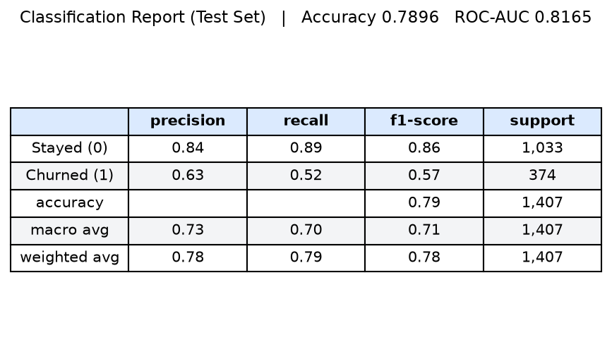

### 7.2 Confusion matrix

| Actual \ Predicted | Predicted Stayed | Predicted Churned |
|---|---|---|
| Actual Stayed | 917 (TN) | 116 (FP) |
| Actual Churned | 180 (FN) | 194 (TP) |

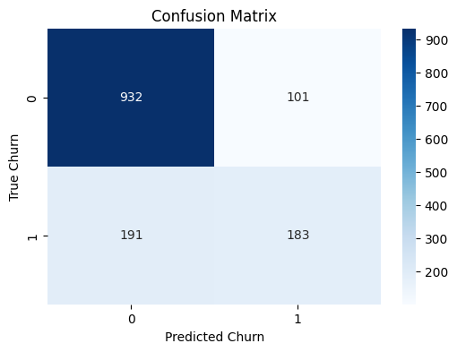

**Reading the results:** the model predicts staying customers reliably (recall 0.89). It identifies about half of the customers who actually churned (churn recall 0.52), meaning many churners are still missed. Because the classes are imbalanced, accuracy alone can be misleading; the ROC-AUC of 0.8165 shows the model separates the two classes reasonably well overall.

### 7.3 Feature importance

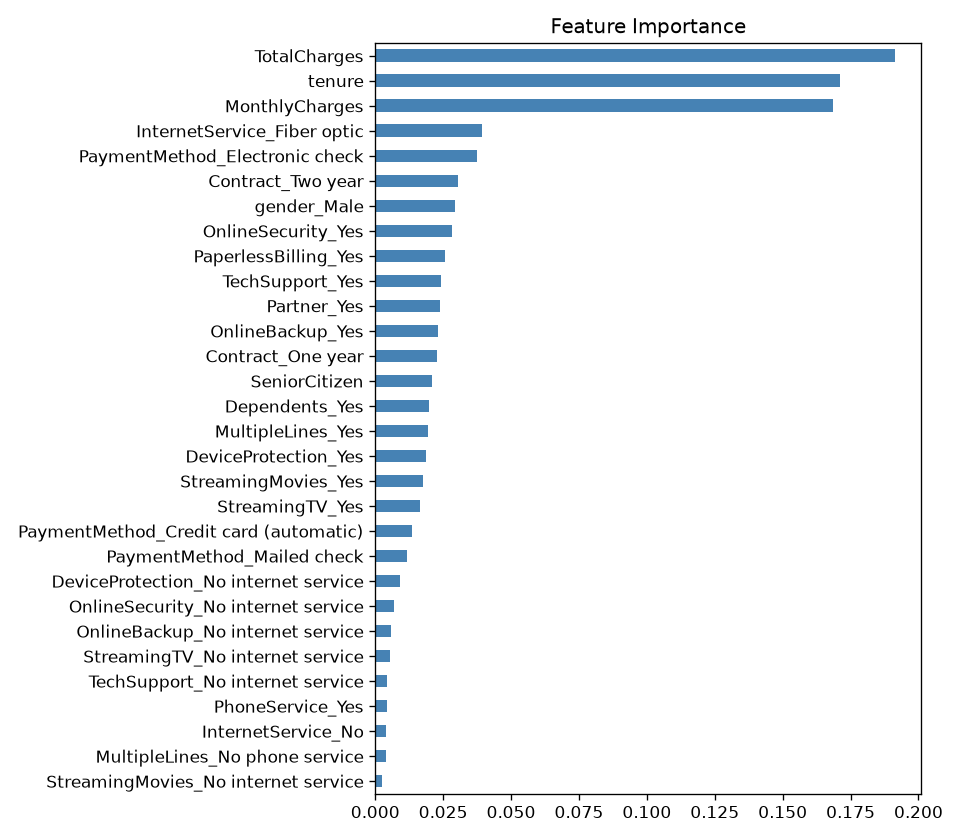

The most influential features are:

`TotalCharges`, `tenure`, `MonthlyCharges`, `InternetService_Fiber optic`, `PaymentMethod_Electronic check`, and `Contract_Two year`. This matches the EDA findings: shorter tenure, higher charges, fiber service, and electronic-check payment are associated with higher churn risk.

## 8. Conclusion and Business Recommendations

**Answer to research question 1 (which characteristics drive churn most):** combining the EDA with the feature-importance plot, the main churn drivers are short `tenure`, high `TotalCharges` and `MonthlyCharges`, Fiber optic internet, Electronic check payment, and Month-to-month contracts; two-year contracts, OnlineSecurity and TechSupport are associated with customers staying.

**Answer to research question 2 (can churn be predicted):** a Random Forest predicts churn with test accuracy 0.7896 and ROC-AUC 0.8165, but it misses about half of churners (churn recall 0.52), so it should be used as a risk flag rather than a final decision.

- **Longer contracts reduce churn.** Offer discounts or bundled plans to move month-to-month customers toward one-year / two-year contracts.
- **Replace electronic check with automatic payment.** Encourage bank-transfer or credit-card auto-pay, possibly with a small incentive.
- **Target high-risk segments.** Short-tenure, high-monthly-charge fiber customers should receive early retention offers before they leave.
- **Act on missed churners.** The churn recall (0.52) means the current model should be used as a risk flag rather than a final decision; human review of flagged customers remains necessary.

## 9. Limitations and Future Work

- The data are simulated and educational, so conclusions are for academic demonstration rather than direct commercial use.
- Churn-class recall is moderate (0.52). Future improvements: class weighting or SMOTE to handle imbalance, adjusting the decision threshold, hyper-parameter tuning (e.g. grid search), and comparing Random Forest with Logistic Regression or Gradient Boosting.

## 10. References

1. Telco Customer Churn dataset, Kaggle, uploaded by BlastChar (simulated IBM data): https://www.kaggle.com/datasets/blastchar/telco-customer-churn (accessed November 2026).
2. Scikit-learn documentation — `RandomForestClassifier`, `train_test_split`, classification metrics: https://scikit-learn.org/stable/ (accessed November 2026).
3. pandas documentation: https://pandas.pydata.org/docs/ ; Seaborn documentation: https://seaborn.pydata.org/ (accessed November 2026).

## Reproducibility and Originality

- `random_state=42` is fixed so the train/test split and model results can be reproduced.
- This draft was completed independently for the continuous assessment; all referenced tools and the dataset are listed above.
- The dataset CSV is excluded from the repository per course guidance; the source link is provided in References.
